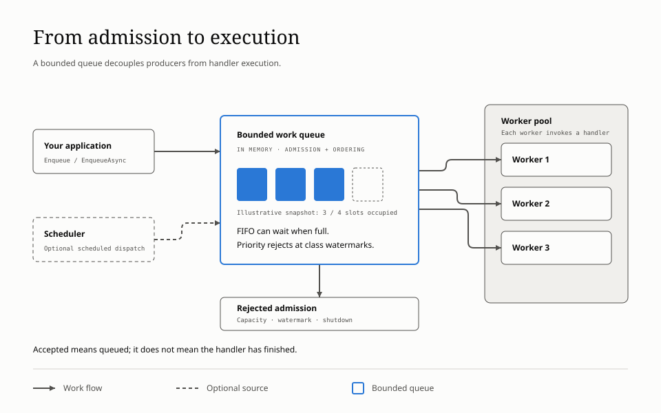

# Bifrost

[](LICENSE)
[](https://dotnet.microsoft.com/)

Bifrost is a library for running background work through a bounded queue and a pool of workers. Define a work type and a handler, then opt into capabilities such as keyed dispatch, handler timeouts and retries, dead-lettering, autoscaling, health checks, metrics, and priority dispatch. A separate scheduler can dispatch recurring jobs to an orchestrator or run them inline.

## How it works



An orchestrator accepts work items into a bounded queue and dispatches them to a pool of workers. Each worker invokes the handler registered for that work type. Admission confirms that an item entered the queue. It does not mean that the handler ran or succeeded. The queue is in memory and does not survive a process restart.

Capabilities are composed through the orchestrator's dependency-injection builder. The packages are designed for trimming and Native AOT.

## Quick start

Register a work type, a handler, and the hosted service that drains the orchestrator on shutdown:

```csharp
services.AddWorkOrchestrator<ResizeImage>(options =>
    {
        options.Capacity = 256;
        options.WorkerCount = 4;
    })
    .WithHandler<ResizeImage, ResizeImageHandler>()
    .Build();
services.AddWorkOrchestratorHostedService<ResizeImage>();
```

Submit work through `IWorkOrchestrator<TWork>` or the producer-only `IWorkWriter<TWork>`. Admission returns an `EnqueueResult`. It does not throw for a full or closed queue:

```csharp
var result = await writer.EnqueueAsync(new ResizeImage(imageId));
if (!result.IsAccepted)
{
    logger.LogWarning("Resize {ImageId} was rejected: {Reason}", imageId, result.Reason);
}
```

The default FIFO queue makes `EnqueueAsync` wait for space when the queue is full. `Enqueue` and `TryEnqueue` never wait. An orchestrator can be drained to finish accepted work, or aborted to cancel its workers and abandon queued work.

## Choosing a dispatch strategy

| Strategy | Use it when | Full queue |
|---|---|---|
| FIFO (default) | Items are independent and admission order is enough. | `EnqueueAsync` waits for space. |
| Keyed (`WithKeyedDispatch`) | Items that share a key, such as a session, account, or document, must not run at the same time, or one key must not take every worker. | Rejects at once. |
| Priority (`UsePriorityDispatch`) | Latency-sensitive work shares one queue with batch work and must go first. | Rejects at once. |

Keyed dispatch and class priority are separate choices. `Build` rejects a builder that uses both.

### Keyed dispatch

Choose keyed dispatch when work for one entity must run one item at a time, or when a busy entity must not block the others. Examples are agent turns in one chat session, updates to one account, and imports for one tenant.

```csharp
services.AddWorkOrchestrator<Turn>(options => options.Capacity = 512)
    .WithKeyedDispatch(
        static turn => (turn.TenantId, turn.SessionId),
        maxPendingPerKey: 8,
        maxConcurrencyPerKey: 1)
    .WithScopedHandler(static async (services, turn, ct) =>
    {
        var runner = services.GetRequiredService<TurnRunner>();
        await runner.RunAsync(turn, ct);
    })
    .WithHandlerResilience(options => options.AttemptTimeout = TimeSpan.FromMinutes(2))
    .Build();
```

- Each key keeps its items in admission order. With `maxConcurrencyPerKey: 1`, the next item of a key starts only after the previous item's handler pipeline and its DI scope have exited. With a higher limit, items start in admission order and can finish in any order.
- A key at its concurrency limit keeps its items queued, and other keys use the free workers. Ready keys share the workers round robin.
- `maxPendingPerKey` limits the queued items of one key. The running items do not count. `Capacity` limits the queued items of all keys.
- With `WithAutoscaling`, scale-up counts only items that a free worker could take now. Items behind a busy key do not add workers.
- Keys with no queued and no running items are removed. Work keys never appear as metric labels.
- The limits apply to one orchestrator in one process. They do not coordinate across replicas.

Keyed admission never waits. Handle each rejection reason:

```csharp
var result = await writer.EnqueueAsync(turn);
var reply = result.Reason switch
{
    null => "Your message is queued.",
    RejectionReason.KeyLimitExceeded => "This session already has messages waiting. Try again soon.",
    RejectionReason.CapacityExceeded => "The service is busy. Try again later.",
    _ => "The service is shutting down.",
};
```

When both limits are full, the global limit wins and the reason is `CapacityExceeded`. Key-limit rejections are not dead-lettered.

### Priority dispatch

Priority dispatch can reorder work by class when latency-sensitive work shares a queue with batch work. Work can be classified at registration or supplied with a class at admission. The `bifrost.orchestrator.queue_wait` metric can help measure queue wait by class before enabling priority dispatch.

Priority dispatch uses a virtual-time key. By default, interactive work receives a 30-second boost, while batch work has no additional penalty. This limits the priority advantage in the key; actual wait times also depend on queue ordering and worker availability. Under pressure, default admission watermarks reject Batch at 90% capacity and Default at 95%, while Interactive can fill the queue. Priority admission rejects immediately, so producers must handle rejection.

| Binding | Ordering | Selection |
|---|---|---|
| `DispatchStrategy.PriorityRelaxed` | Relaxed two-choice priority ordering | Explicit selection; designed for concurrency |
| `DispatchStrategy.PriorityExact` | Exact minimum key under one lock | Explicit selection when exact priority ordering matters |

MultiQueue trades ordering accuracy for concurrency; it does not guarantee that the minimum key is selected on every dequeue. See the [priority queue background](src/Bifrost.Concurrency/BACKGROUND.md), the [benchmarks](docs/benchmarks/), and the [breaking API migration](docs/migrations/2026-10-priority-api.md).

## Admission policies and handler policies

Bifrost applies two kinds of policy at two different points.

| Point | Policies | What they decide |
|---|---|---|
| Admission, inside `EnqueueAsync`, before the item is queued | `Capacity`, `maxPendingPerKey`, priority watermarks, `WithAdmissionResilience` | Whether the item enters the queue. The caller gets the answer as an `EnqueueResult`. |
| Handler, around each run of an accepted item | `WithHandlerResilience`, `WithDeadLetterQueue`, `WithHandlerDecorator` | How long an attempt can run, which failures are retried, and where the final failure goes. |

- **Admission resilience** (`WithAdmissionResilience`, also available as `WithResilience`) adds Polly retry and timeout around `EnqueueAsync`. It acts when a full FIFO queue makes the write wait or the enqueue throws a transient exception. It does not retry rejections returned as `EnqueueResult`, synchronous `Enqueue` or `TryEnqueue` calls, or handler failures.
- **Handler resilience** (`WithHandlerResilience`, in `Bifrost.Resilience`) adds a cooperative timeout for each handler attempt and short, opt-in retries for failures that the caller classifies as transient. Retries are off by default. A failure after host shutdown or abort is never retried. Each attempt gets a fresh DI scope. The worker and the key slot stay held across all attempts and retry delays.
- **Dead-lettering** records the final handler failure and eligible admission rejections. Shutdown rejections, key-limit rejections, and canceled enqueues are not dead-lettered. The default dead-letter queue is in memory, is bounded, and drops its oldest item when full.

Each accepted item has one retry owner. With both handler resilience and dead-lettering, handler resilience retries and the dead-letter queue only captures the final failure:

```csharp
services.AddWorkOrchestrator<SendInvoice>()
    .WithHandler<SendInvoice, SendInvoiceHandler>(ServiceLifetime.Scoped)
    .WithHandlerResilience(options =>
    {
        options.AttemptTimeout = TimeSpan.FromSeconds(30);
        options.MaxRetries = 2;
        options.ShouldRetry = static ex => ex is HttpRequestException;
    })
    .WithDeadLetterQueue(options => options.MaxRetries = 0)
    .WithAdmissionResilience()
    .Build();
```

A non-zero dead-letter `MaxRetries` next to handler resilience fails options validation on start. Without handler resilience, only the dead-letter queue retries handler failures, and its retries are immediate. Leave retries off for work that can repeat side effects, such as agent turns that call tools.

## Where recovery ownership begins

`EnqueueResult.Accepted` means that the item entered an in-memory queue in this process. Bifrost then owns running it while the process lives: it enforces the limits, runs the handler, applies handler policies, and records one terminal outcome (succeeded, failed, canceled, or abandoned). Bifrost does not persist accepted work. If the process stops, queued items and running attempts are lost and are not run again after a restart.

Recovery belongs to the application or to a durable owner outside Bifrost:

- Save the work's input before you submit it, and commit the effect inside the handler. Then the application can find unfinished work at startup and submit it again. Use a stable operation ID so that a repeated run leaves one effect.
- When work must survive a restart, submit it to a durable runtime, such as the Agent Framework Durable Task extension or a Wolverine durable queue. The durable runtime owns retries and completion, and Bifrost runs the local attempt.
- A rejected item never entered the queue. The caller decides whether to try again.

## Samples

| Sample | Shows |
|---|---|
| [Agent Framework turns](samples/Bifrost.AgentFramework.Sample/README.md) | Session-keyed background turns with Microsoft Agent Framework, `EnqueueResult` handling, a scoped handler that awaits `AIAgent.RunAsync`, and a handler timeout with retries off. Runs offline. |
| [EF Core scoped handler](samples/Bifrost.EntityFrameworkCore.Sample/README.md) | `AddDbContext` with a scoped handler, keyed by document, and the in-memory admission boundary. |
| [Keyed AOT smoke](samples/Bifrost.Keyed.AotSmoke/Program.cs) | Keyed dispatch, scoped handlers, and handler resilience published with Native AOT. |
| [Scheduling AOT smoke](samples/Bifrost.Scheduling.AotSmoke/Program.cs) | Scheduler registration and dispatch modes. |

Run a sample with `dotnet run -c Release --project samples/<name>`. The Agent Framework and EF Core packages are referenced only by their samples.

## Other capabilities

- **Autoscaling** adjusts the worker pool using queue utilization and configured watermarks.
- **Health checks** report orchestrator and queue health through .NET health check integration.
- **OpenTelemetry** records processing counts and duration, terminal outcomes, handler attempts, dead-letter activity, queue wait, rejections, and pending, ready, and blocked queue depth automatically. Handlers need no metrics code. See the [automatic metrics migration](docs/migrations/2026-11-automatic-metrics.md).
- **Event stream** publishes enqueue, completion, and dead-letter events for subscribers.

## Scheduling

`LevelUp.Bifrost.Scheduling` adds interval, cron, and one-shot scheduling with inline, orchestrator, or custom dispatch. The default schedule store is in memory, and multiple scheduler instances can produce duplicate fires; run a single scheduler process unless your deployment accounts for that behavior. See the [scheduling sample](samples/Bifrost.Scheduling.AotSmoke/Program.cs) for registration and dispatch examples.

## Packages

| Package | Purpose |
|---|---|
| `LevelUp.Bifrost.Core` | Orchestrator abstractions and options |
| `LevelUp.Bifrost` | Orchestrator, handlers, keyed dispatch, and built-in decorators |
| `LevelUp.Bifrost.Concurrency` | Relaxed MultiQueue priority queue, usable independently |
| `LevelUp.Bifrost.HealthChecks` | Health check integration |
| `LevelUp.Bifrost.OpenTelemetry` | Metrics integration |
| `LevelUp.Bifrost.Resilience` | Admission and handler resilience with Polly |
| `LevelUp.Bifrost.Scheduling.Core` | Scheduling abstractions |
| `LevelUp.Bifrost.Scheduling` | Scheduler and dispatch implementations |
| `LevelUp.Bifrost.Scheduling.Testing` | Scheduler testing helpers |

## Build and test

Install the .NET 10 SDK; [global.json](global.json) specifies the SDK version and roll-forward policy.

```bash
git clone https://github.com/lvlup-sw/bifrost.git
cd bifrost
dotnet build src/Bifrost.sln -c Release
dotnet test --solution src/Bifrost.sln
```

Tests use TUnit and Microsoft Testing Platform. Use `dotnet test --project src/Bifrost.Tests` for one project. The C# examples in this README are compiled and run by `ReadmeExamplesTests` in that project. The full solution includes stress tests; CI runs those separately from its regular pull-request checks. The [documentation index](docs/README.md) links to design notes, research, and benchmarks. Release history is in [CHANGELOG.md](CHANGELOG.md).

## License

Apache 2.0. See [LICENSE](LICENSE).

<!-- ci-lanes scratch proof: docs-only PR for targeting. -->
