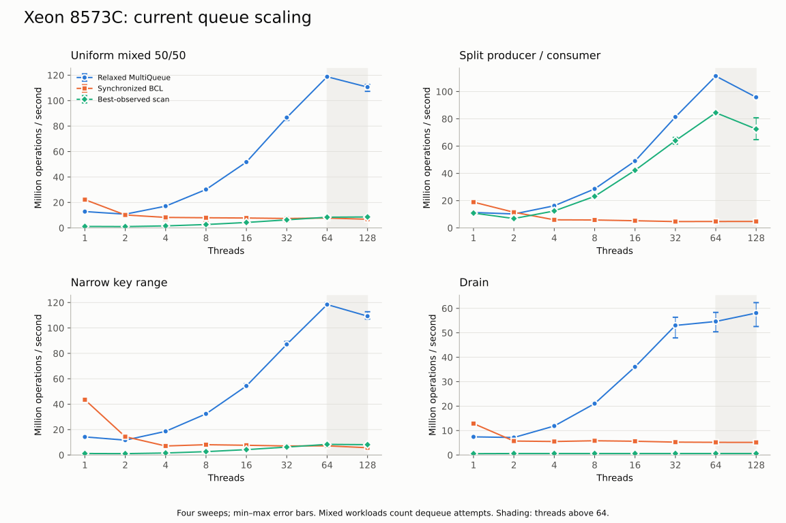
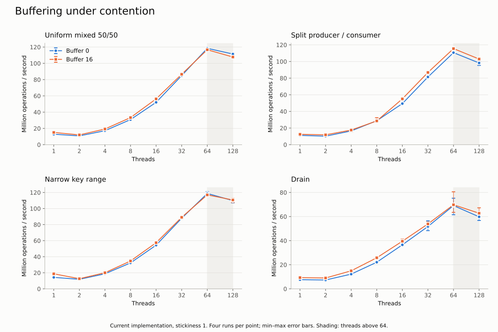
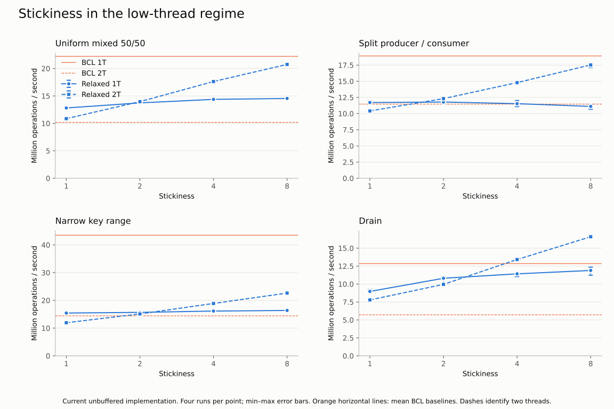
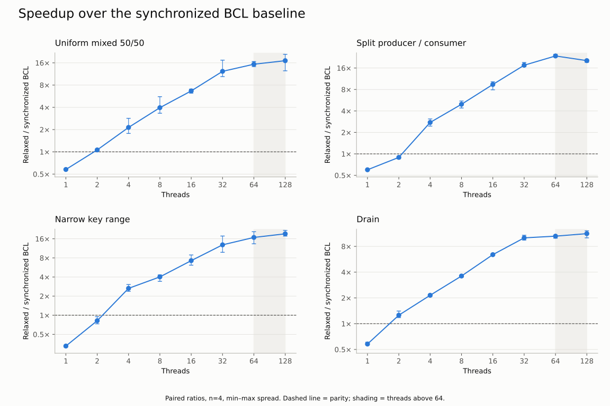
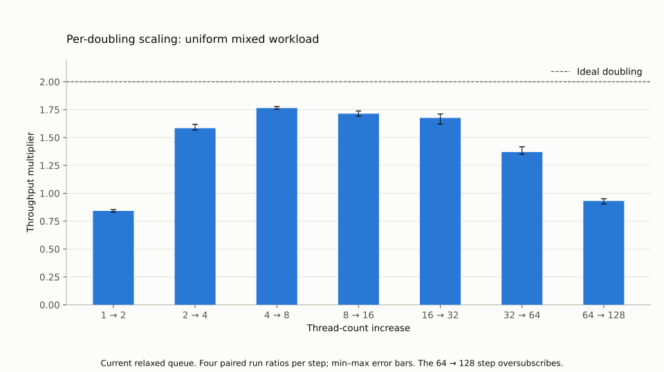
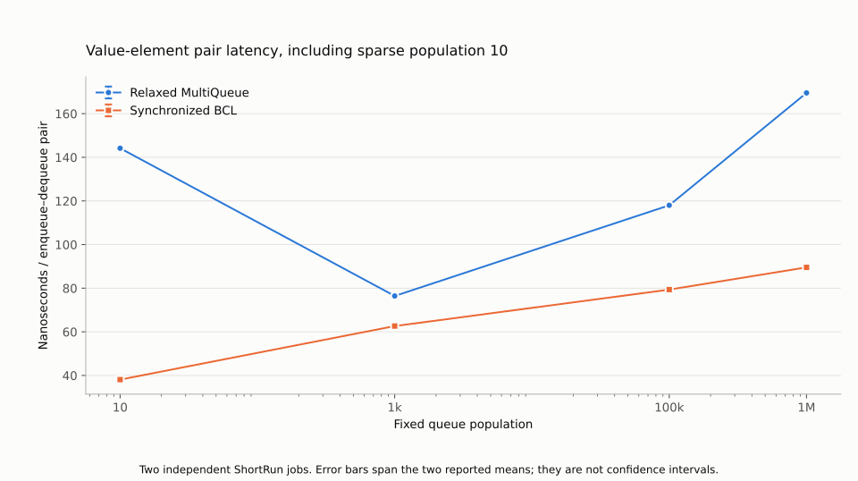
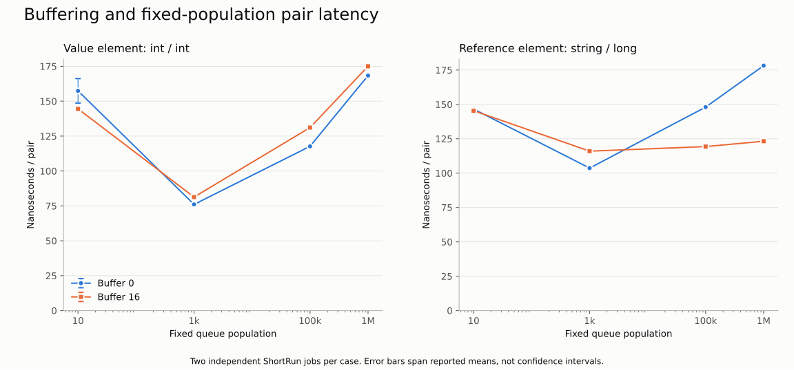

# Xeon 8573C benchmark campaign — October 2026

This campaign measures the comparer-safe priority API implementation in Bifrost v0.6.0 with the toolkit committed in PR #74.

At 64 threads, the relaxed queue averages 54.6–118.8 Mops/s across the four workloads, 10.5–23.6× the synchronized BCL baseline on this host.

## Environment and protocol

- Source/harness commit: `e31bddd4c64463ae53d0cd0760f692b25fd03de5`.
- Host: Azure Standard_D64s_v6, eastus2 zone 1; INTEL(R) XEON(R) PLATINUM 8573C; 64 logical / 32 physical cores, one NUMA node.
- OS: Ubuntu 24.04.5 LTS. The June report used Ubuntu 24.04.4 LTS.
- Runtime: .NET 10.0.9; SDK 10.0.301; Workstation GC. The raw archive records OS image, package versions, affinity, CPU policy and environment.
- Four independent three-second server sweeps per variant, including 128-thread oversubscription. Drain rates use actual elapsed drain time.
- Two independent BenchmarkDotNet ShortRun jobs per latency/allocation class. These timings are per enqueue/dequeue pair.
- Original/current ABBA and pre-inlining/pre-copy/current/current/pre-copy/pre-inlining order, three blocks each. Each control has six process observations per comparison family.
- All verification and control builds preceded timing. No performance processes ran concurrently.

## Current scaling at 64 threads

| Workload | Relaxed Mops/s: mean (min–max), n=4 | Speedup over synchronized BCL |
|---|---:|---:|
| UniformMixed5050 | 118.75 (117.91–119.71) | 15.32× |
| SplitProducerConsumer | 111.34 (110.39–111.90) | 23.62× |
| NarrowKeyRange | 118.41 (117.85–119.92) | 16.81× |
| Drain | 54.63 (50.42–58.34) | 10.53× |

Mixed and split workload rates include dequeue attempts, including unsuccessful attempts. They are not all successful-delivery rates.
`MultiQueueDequeueMin` in raw CSV is a legacy label for the best-observed scan, not an exact concurrent minimum.
The synchronized BCL baseline replaces the removed standalone locking queue; June baseline descriptions do not describe this implementation.

## Buffering and stickiness

## Latency and allocation

Maximum allocation across all reported BenchmarkDotNet pair rows: 0 B per benchmark invocation (one enqueue/dequeue pair). See [the complete latency table](latency-summary.csv) for every method, population and buffer setting.
The unsynchronized BCL control is a single-thread reference only; it is not the thread-safe baseline.

## Implementation tradeoffs on this host

| Metric | Original | Current | Current change | Unit |
|---|---:|---:|---:|---|
| Dense, 4-thread throughput | 16.95 | 17.30 | +2.03% | Mops/s |
| Sparse buffered reference pair | 121.33 | 123.18 | +1.53% | ns/pair |
| Dense unbuffered reference stripe proxy | 157.55 | 164.54 | +4.44% | ns/pair |
| Independent reference stripe | 158.46 | 164.52 | +3.83% | ns/pair |

Throughput increases are faster; latency increases are slower. Source-direct Mops/s counts enqueue and dequeue operations separately.
The source-direct queue uses 32 stripes and populations 16/4096; the server sweep uses the 256-stripe default. Original control `6800ae0` lacks the current arbitrary-comparer exception guarantee.
Source-direct reference payloads use object/int; buffered BDN reference rows use string/long.
Stripe proxies exclude whole-queue routing. Their results do not replace full-matrix measurements or measure production lock-hold duration.
The complete [validation table](validation-summary.csv) records every payload/comparer/population/buffer case, batch p90 values, and allocation counters.
Batch p90 is the percentile of batch averages, not individual-operation tail latency. Min–max is spread across process observations, not a confidence interval.

### October optimization controls

These comparisons isolate the inlining and copy/guard changes using the committed reverse patches and verified source hashes.
`old` identifies the pre-inlining control; `preprofile` identifies the pre-copy/guard control. Each row compares six process observations per revision.

| Metric and change | Before optimization | Current | Current change | Unit |
|---|---:|---:|---:|---|
| Inlining: dense 4-thread throughput | 17.22 | 17.41 | +1.10% | Mops/s |
| Copy/guard: sparse buffered throughput | 23.68 | 24.02 | +1.42% | Mops/s |
| Copy/guard: sparse buffered reference pair | 125.34 | 122.75 | -2.07% | ns/pair |
| Inlining: dense reference stripe proxy | 163.64 | 165.42 | +1.09% | ns/pair |
| Inlining: independent reference stripe | 163.69 | 163.95 | +0.16% | ns/pair |

These are same-host comparisons, separate from the original-versus-current family above. Different compilation and workload contexts can produce different stripe results.

## Verification and limits

The preparation logs record regular and stress tests, both Native AOT samples, 72 trace hashes, and 160 seeded rank/delay records.
Original and current trace/quality outputs match. Reconstructed optimization controls also match those outputs and their committed source hashes.
Sequential trace equivalence does not establish every concurrent interleaving or a universal rank bound.
The reported spread is descriptive. Two ShortRun jobs or six process medians do not establish a precise one-percent change.
VM host contention, OS patch differences and workload shape limit comparisons with June measurements. Compare this campaign's revisions on this host.
These queue-level benchmarks do not measure complete orchestrator or handler execution latency.

## Data and reproduction

- [Server table](server-summary.csv), [paired speedup table](speedup-summary.csv), [latency table](latency-summary.csv), [control table](validation-summary.csv), and [machine-readable summary](summary.json).
- The raw archive retains each repeat separately, complete stdout/stderr, BenchmarkDotNet artifacts, control sources/binaries, source hashes, verification logs and process order.
- The compact [raw dataset](raw/) retains every numeric input, validation stdout, compressed BDN logs, verification logs, provenance and process order. [Collection protocol and archive checksum](raw/protocol.json).
- Install `analysis-requirements.txt`, then run `python analyze_campaign.py raw OUTPUT_DIRECTORY` from this directory to reproduce the tables and figures. The complete extracted archive is also a supported input.
- [Campaign runbook](../../2026-10-priority-api-benchmark-runbook.md) describes the protocol and units.
